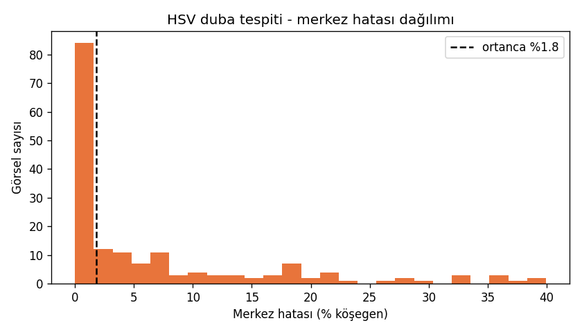
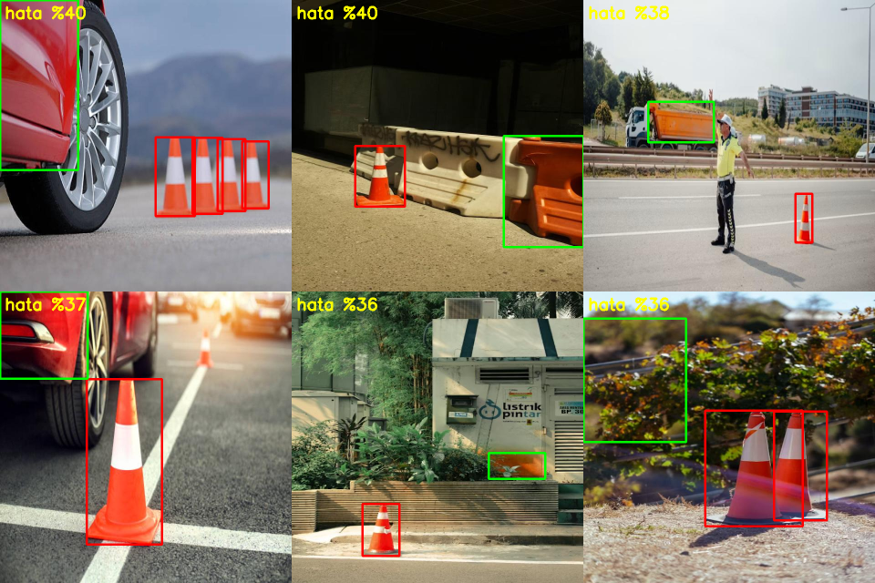

# İKA Görüntü İşleme — Piksel Fark Hesaplama

İKA Otonomi & Görüntü İşleme 2027 Yetkinlik Programı — **Level 1** çalışması.

## Amaç
1. Ana görüntünün merkezini bulmak
2. Görüntüde nesne tespiti (duba, levha, hedef)
3. Tespit edilen nesnenin görüntü merkezine **X/Y piksel uzaklığını** hesaplamak (`dx`, `dy`, normalize `ex`, `ey`)

## İşaret Kuralı
- `dx = cx − W/2` → **+** ise nesne merkezin **sağında**
- `dy = cy − H/2` → **+** ise nesne merkezin **altında** (OpenCV koordinatı)
- `ex = dx / (W/2)`, `ey = dy / (H/2)` → [-1, 1] aralığında, çözünürlükten bağımsız

## Kurulum
```bash
python -m venv .venv
.venv\Scripts\activate
pip install -r requirements.txt
```

## Klasör Yapısı
```
src/        # merkez, tespit, piksel fark, video çalıştırıcı
tools/      # HSV ayarlayıcı vb. yardımcı scriptler
tests/      # pytest birim testleri
data/       # küçük örnek görüntüler (veri setleri repoda tutulmaz)
outputs/    # görsel çıktılar
docs/       # referans analizi, teknik not
```

## Veri Setleri
Roboflow kaynaklı (duba / levha / hedef). Boyut nedeniyle repoya eklenmez — linkler ve istatistikler buraya eklenecek.

## İlerleme
- [x] Adım 1 — Görüntü merkezi
- [x] Adım 2 — Nesne tespiti (HSV + contour; YOLO ileride)
- [x] Adım 3 — Piksel fark hesaplama
- [x] Adım 4 — Video / webcam + CSV log (kamera testi bekliyor)
- [x] Adım 5 — Birim testler (22 test: `python -m pytest tests`)
- [x] Adım 6 — Dokümantasyon ([teknik not](docs/teknik_not.md))

## Referans
- [Poyqraz/Line-Tracking-and-Anomaly-Detection](https://github.com/Poyqraz/Line-Tracking-and-Anomaly-Detection) — Teknofest 2024 AUV kablo takibi

## Sonuçlar (HSV duba tespiti, 170 etiketli görsel)

Veri: Roboflow `Denemeler_Montagne v6`, sadece `Duba` sınıfı (`tools/filter_duba.py`). Değerlendirme: `python tools/evaluate.py`.

| Metrik | Değer |
|---|---|
| Etiketli görsel | 170 (train 115 / valid 38 / test 17) |
| Merkez hatası, **ortanca** (köşegene oranla) | **%1,8** |
| Merkez hatası, ortalama | %6,9 |
| Hata < köşegenin %5'i | 107/170 (%62,9) |
| Hata < köşegenin %10'u | 130/170 (%76,5) |
| IoU ortanca / ortalama | 0,45 / 0,46 |



### Başarısız örnekler ve kök neden
`outputs/eval_worst.png` (yeşil = tespit, kırmızı = etiket):



- Dedektör **her görselde bir şey buluyor** (miss = 0), ama bu iyi bir haber değil: "duba yok" durumunu ayırt edemiyor. Asıl sorun **yanlış pozitif**.
- Yanlış tespitler: **kırmızı araba**, **turuncu bariyer/kamyon**, **sonbahar yaprakları**. Hepsi dubayla aynı HSV aralığında.
- Yalnız renk yeterli bir ayırt edici değil. Dubanın **kırmızı-beyaz şerit deseni + konik şekil** kullanılmalı.
- Birden fazla duba olan karelerde sadece en büyük blob seçiliyor.
- IoU düşük: gölgedeki kenar maskeden düşüyor, kutu daralıyor.

### Sonraki adım
Renk + şekil/şerit doğrulaması ya da YOLO (Level 2) ile aynı metrik üzerinde karşılaştırma.


